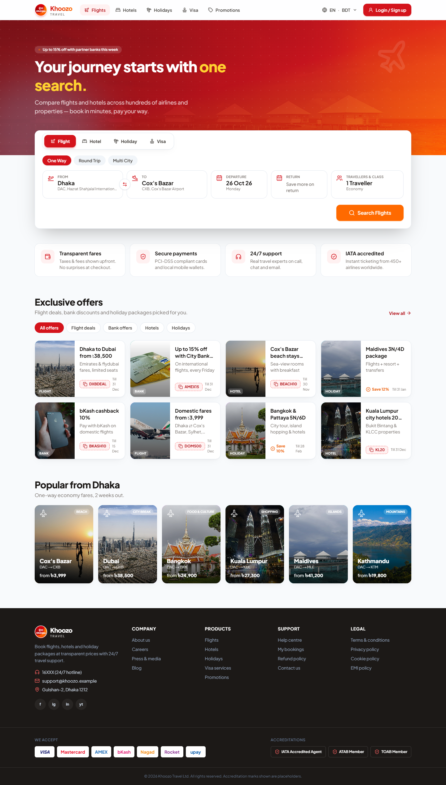

<p align="center"></p>

# Khoozo — Online Travel Agency (OTA)

A production-style OTA web app for the Bangladesh market — **flights, hotels, holiday packages and visa services (including student visas / study abroad)** — inspired by GoZayaan and ShareTrip.

Built with **Next.js 16 (App Router), React 19, TypeScript, Tailwind CSS v4, Lucide icons and Zod**, packaged as a **Docker** image.

---

## Features

### Flights
- One-way, round-trip and multi-city search (up to 5 legs)
- Airport auto-suggest (30 airports — DAC, CXB, DXB, JFK, LHR …) with keyboard navigation
- Passenger (adult / child / infant rules) & cabin class picker
- Results with animated loading skeletons, sticky search summary + "Modify search"
- Filters: stops, price slider, airlines, departure / arrival time windows, refundable
- Sort: recommended, cheapest, fastest, earliest
- Flight card: airline, times (+1 day), stops & layovers, baggage, refundability, seats left, expandable segment & fare details

### Hotels
- City / area search with rooms & guests configuration
- Filters: star rating, price per night, neighbourhood, amenities, free cancellation
- Hotel cards with real photos, ratings, amenities, breakfast / cancellation badges

### Checkout & payments
- Traveller forms with real validation (names, age-by-type on travel date, passport 6-month validity for international trips, BD mobile numbers)
- Fare breakdown: base + taxes + service charge − promo discount = total payable
- Promo codes (e.g. `DOM500`, `AMEX15`, `BEACH10`) with category rules and caps
- 15-minute fare-hold countdown
- Mock payment gateway: cards (Luhn check, brand detection, expiry) and mobile wallets (bKash, Nagad, Rocket, upay)
- Booking confirmation with PNR, printable e-ticket / voucher

### Holiday packages
- 6 curated packages with sample itineraries and real destination photos
- **Customise any package or build your own trip**: destination, dates, nights, travellers & rooms, hotel category (3★/4★/5★), meal plan, return flights, add-ons (transfers, tours, insurance, visa assistance, eSIM, private guide)
- Live price breakdown; the server **re-computes the quote** and rejects tampered totals (HTTP 409)

### Visa services & study abroad
- 23 countries across Asia, Middle East, Europe, North America and Oceania
- Visa types: **Tourist, Student, Business, Work, Transit**
- Per-country requirements: processing time, validity, stay, entry, fees, document checklist
- **Student visa detail** for UK (Student route / CAS), US (F-1 / I-20), Canada (Study permit / LOA + PAL), Australia (Subclass 500 / CoE), Germany (blocked account), Malaysia (EMGS), China and more — acceptance document, proof of funds, language tests, work rights, post-study options
- Online application with document upload checklist and server-side validation

### Platform
- Brand palette derived from the Khoozo logo (red `#d4141c` → orange `#ff6a00`)
- Fully responsive, app-like mobile layout with bottom tab bar
- BDT / USD currency switcher, login / sign-up modal (demo)
- "My bookings" for flights, hotels, holidays and visa applications
- Search history, shareable result URLs, session-persisted cart
- Health-check endpoint and Docker `HEALTHCHECK`

---

## Run with Docker (recommended)

```bash
cp .env.example .env        # optional; defaults to the mock provider
docker compose up -d --build
```

Open http://localhost:3000 · health check: `GET /api/health`

## Live demo (GitHub Pages)

The `demo` branch deploys a static, server-less build to **https://mahbub06ru4.github.io/khoozo_ota/** via `.github/workflows/pages.yml`.
In this mode (`STATIC_EXPORT=1`) the API routes are dropped and search, visa and holiday booking run in the browser on the built-in demo data; bookings are stored in the visitor's browser. No database or paid API is needed.

Build it locally:

```bash
STATIC_EXPORT=1 PAGES_BASE_PATH=/khoozo_ota npm run build   # move app/api aside first
node scripts/flatten-export-segments.mjs out
```

## Run locally

```bash
npm install
npm run dev
```

---

## Architecture

```
app/
  page.tsx                    Landing: hero, Flight / Hotel / Holiday / Visa search tabs, offers, popular routes
  search/[kind]/              Flight & hotel results (query in ?q= — shareable)
  checkout/                   Travellers → payment → confirmation
  holidays/, holidays/[slug], holidays/custom   Packages, details + customiser, build-your-own
  visa/, visa/[country]       Visa hub, study abroad, country requirements + application
  bookings/, promotions/
  api/flights/search          POST  (zod-validated → configured supplier)
  api/hotels/search           POST
  api/visa/product            GET   ?country=&type=&nationality=
  api/visa/applications       POST
  api/holidays/bookings       POST  (server-side price re-calculation)
  api/health                  GET
components/                   layout, search, results, checkout, holidays, visa, ui
context/AppProvider.tsx       Global state (React Context + reducer, persisted to storage)
services/                     Supplier adapters behind one TravelProvider interface
  mock.ts                     Deterministic generated inventory (default)
  amadeus.ts                  Amadeus Self-Service flight offers (OAuth token cached)
  duffel.ts                   Duffel offer requests
  visa.ts                     Visa provider (mock; swap for a real visa-data API)
lib/                          data, pricing, filters, validation, schemas, utils
scripts/
  screenshots.mjs             Full-page screenshot generator (Playwright)
  fetch-images.mjs            Downloads freely licensed photos from Wikimedia Commons
```

### Switching to a real supplier

Set `TRAVEL_PROVIDER=amadeus` (with `AMADEUS_CLIENT_ID` / `AMADEUS_CLIENT_SECRET`) or `TRAVEL_PROVIDER=duffel` (with `DUFFEL_ACCESS_TOKEN`) in `.env` and restart. Keys stay on the server — the browser only talks to `/api/*`. Hotel search falls back to mock data until a hotel supplier is wired. Visa data uses a mock provider (no free public visa API exists); replace `services/visa.ts` with a licensed source.

---

## Screenshots

Full-page captures are in [`screenshots/`](screenshots) — regenerate with `node scripts/screenshots.mjs` while the app runs.

| Area | Files |
| --- | --- |
| Home (flight, hotel, holiday, visa tabs) | `01-home/` |
| Flight tickets: results, details, checkout, payment, e-ticket | `02-flight-tickets/` |
| Hotels: results, checkout | `03-hotels/` |
| Holidays: packages, Dubai package, build-your-own, confirmation | `04-holiday-packages/` |
| Visa & study abroad: hub, UAE tourist, UK student, Canada application | `05-visa-study-abroad/` |
| My bookings | `06-account/` |



---

## Photo credits

Photos are from Wikimedia Commons under their respective free licences; author, licence and source for every image are listed in [`public/images/CREDITS.json`](public/images/CREDITS.json).

## Status

Prototype: authentication, payments, visa lodgement and bookings are simulated and stored in the browser. Before going live you need a real auth provider, a payment gateway (e.g. SSLCommerz / bKash PGW / Stripe), a database, supplier ticketing (order creation, not just search) and a licensed visa-requirements source. Accreditation marks shown are placeholders.
